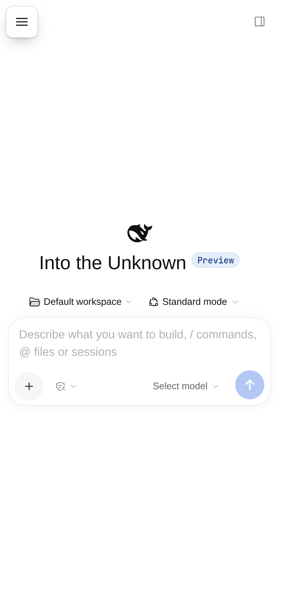
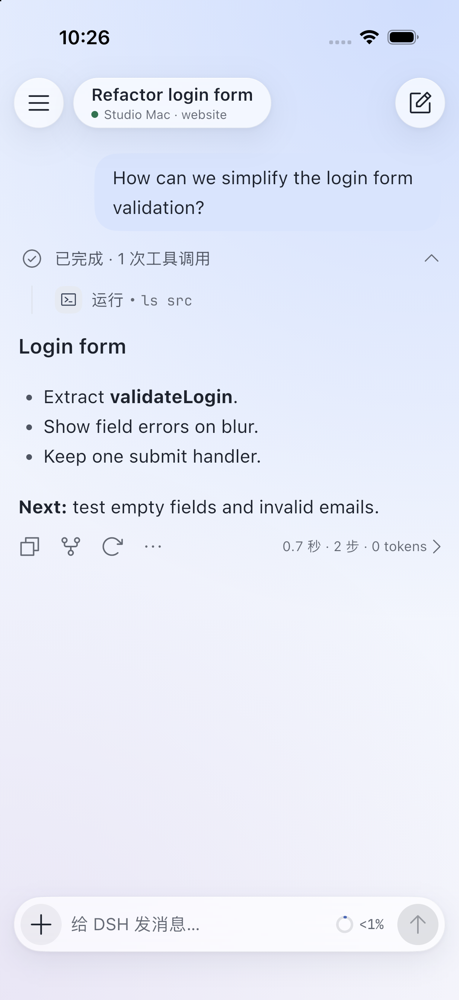

  
  <h1>YuRemote · 鱼鱼远程</h1>
  
Take DeepSeek Harness (DSH) with you in a browser or mobile app, while your work stays on your host.

  
<a href="README.md" lang="zh-CN">简体中文</a> · <strong>English</strong>

  

    
    
    
    
    
    
  

## What is YuRemote?

YuRemote is a remote-access plugin and mobile app for DSH. Your computer keeps running DSH and handling conversations, tool calls and workspace files. Switch to a phone, tablet or another computer without moving your workspace or running DSH on the phone.

- **Web remote:** Keep using the DSH interface in a browser. The layout adapts to phones, with a sidebar for switching workspaces and conversations.
- **Mobile app:** Continue chats, stream replies and respond to approval requests on iOS or Android. Browse workspaces and attach files when the host supports it.
- **Connections and devices:** Connect directly on your LAN or use a relay you run. Sign in with a password or a one-time pairing QR code, and revoke device access from the host.

## Screenshots

  <table>
    <thead>
      <tr>
        <th scope="col" align="center">Mobile browser</th>
        <th scope="col" align="center">iOS app</th>
      </tr>
    </thead>
    <tbody>
      <tr>
        <td align="center"></td>
        <td align="center"></td>
      </tr>
    </tbody>
  </table>

## Get started

1. [Install the plugin on the computer running DSH](docs/GETTING-STARTED.md#install-on-the-host), then restart DSH.
2. In the DSH sidebar, open **Remote access → General**, enable remote access and set an access password.
3. On the same Wi-Fi, choose how to connect:
   - **Browser:** Open the address shown under **Local network** and enter the password, or scan the pairing QR code with your phone’s camera.
   - **Mobile app:** Download the Android APK or unsigned iOS IPA from the [release page](https://github.com/tsukii12/dsh-YuRemote/releases/latest). Follow the [installation guide](docs/APP.md#install), then enter the address and password in the app or [scan the pairing QR code](docs/APP.md#connect-or-pair).

### Connect away from home

[Deploy a relay](docs/DEPLOY-SERVER.md) on a server you trust, then connect it from **Remote access → Public access** in DSH. Open the resulting HTTPS visitor address in your browser or mobile app, keeping the full tunnel path. YuRemote does not provide a hosted relay, and you do not need to expose DSH’s own Web port.

## Documentation

| Guide | What you’ll find |
| --- | --- |
| [Web remote and host setup](docs/GETTING-STARTED.md) | Plugin installation, LAN pairing, settings and troubleshooting |
| [Mobile app](docs/APP.md) | Install, connect, pair and build for iOS or Android |
| [Public access and relay](docs/DEPLOY-SERVER.md) | Self-hosting, HTTPS and bringing your own tunnel |
| [Architecture and development](ARCHITECTURE.md) | Gateway, authentication and repository map; see also [development and testing](docs/TESTING.md) |
| [Project resources](docs/README.md#english) | Docs index, [changelog](CHANGELOG.md) and [security reporting](SECURITY.md) |

## License

The server, plugin, relay, web remote and installers use [MIT](LICENSE). The mobile app and accompanying Dart packages use [AGPL-3.0](app/LICENSE), including the dsh-Go-derived code and the `dsh_portal` adapter. See [app license and credits](docs/APP.md#license-and-credits) for upstream and third-party notices. YuRemote is not an official DeepSeek product.
