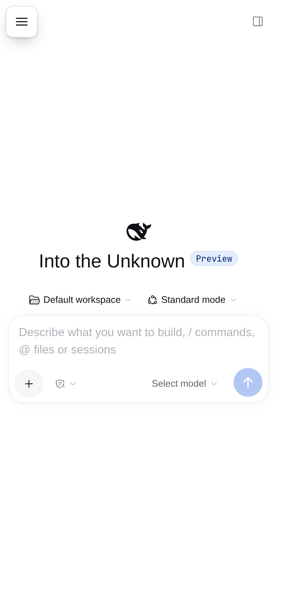
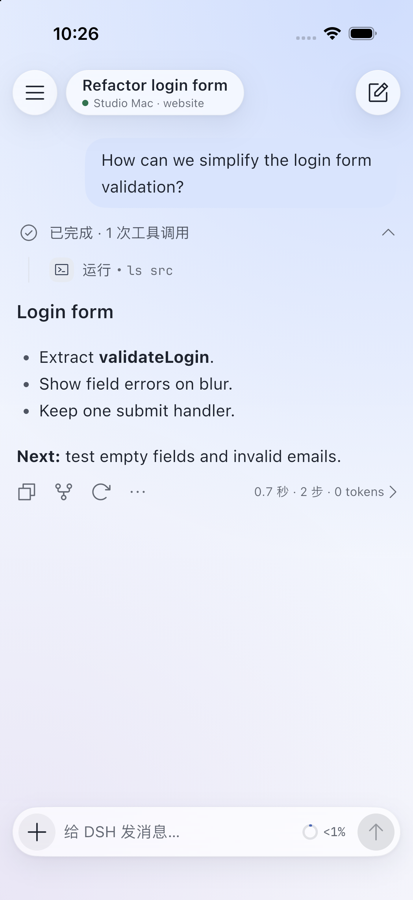

  
  <h1>鱼鱼远程 · YuRemote</h1>
  
用浏览器或移动应用远程访问 DeepSeek Harness，工作仍留在你的主机上。

  
<strong>简体中文</strong> · <a href="README.en.md" lang="en">English</a>

  

    
    
    
    
    
    
  

## 鱼鱼远程是什么？

鱼鱼远程是 DeepSeek Harness（dsh）的远程访问插件和移动应用。电脑继续运行 dsh，处理会话、工具调用和工作区文件；你可以换到手机、平板或另一台电脑继续操作，不用迁移工作区，也不用在手机上运行 dsh。

- **网页端：** 在浏览器中继续使用 dsh；窄屏布局适合手机，侧栏可切换工作区和会话。
- **移动应用：** 用 iOS 或 Android 应用继续对话、接收流式回复、处理授权请求；主机支持时，可浏览工作区和添加附件。
- **连接与设备管理：** 在同一局域网内直连，或通过自建中继跨网访问。支持密码登录、一次性二维码配对，也可在主机上撤销设备授权。

## 界面截图

  <table>
    <thead>
      <tr>
        <th scope="col" align="center">手机浏览器</th>
        <th scope="col" align="center">iOS 应用</th>
      </tr>
    </thead>
    <tbody>
      <tr>
        <td align="center"></td>
        <td align="center"></td>
      </tr>
    </tbody>
  </table>

## 快速开始

1. [在运行 dsh 的主机上安装插件](docs/GETTING-STARTED.zh-CN.md#在主机上安装)，然后重启 dsh。
2. 在 dsh 侧栏打开 **远程访问 → 基本设置**，启用远程访问并设置访问密码。
3. 在同一 Wi-Fi 下，选择一种连接方式：
   - **浏览器：** 打开 **局域网访问** 显示的地址并输入密码，也可用手机相机扫描配对二维码。
   - **移动应用：** 从[发布页](https://github.com/tsukii12/dsh-YuRemote/releases/latest)下载 Android APK 或未签名的 iOS IPA。参照[安装指南](docs/APP.zh-CN.md#安装)安装，然后在应用内输入地址和密码，或[扫描配对二维码](docs/APP.zh-CN.md#连接或配对)。

### 在外网访问

在你信任的服务器上[部署中继](docs/DEPLOY-SERVER.zh-CN.md)，再到 dsh 的 **远程访问 → 公网访问** 连接它。在浏览器或移动应用中使用生成的 HTTPS 访客地址，保留完整的隧道路径。鱼鱼远程不提供托管中继，也不需要把 dsh 自己的 Web 端口暴露到公网。

## 文档

| 指南 | 内容 |
| --- | --- |
| [网页端与主机配置](docs/GETTING-STARTED.zh-CN.md) | 插件安装、局域网配对、远程访问设置和排查 |
| [移动应用](docs/APP.zh-CN.md) | iOS、Android 安装，连接、配对与源码构建 |
| [公网与中继](docs/DEPLOY-SERVER.zh-CN.md) | 自建中继、HTTPS 和已有隧道接入 |
| [架构与开发](docs/ARCHITECTURE.zh-CN.md) | 网关、认证模型与仓库结构；另见[开发与测试](docs/TESTING.zh-CN.md) |
| [项目维护](docs/README.md#简体中文) | 文档目录、[更新日志](CHANGELOG.md)与[安全报告渠道](SECURITY.md) |

## 许可

服务端、插件、中继、网页远程端与安装脚本采用 [MIT](LICENSE)。移动 App 及随附的 Dart 软件包采用 [AGPL-3.0](app/LICENSE)，包括源自 dsh-Go 的代码和 `dsh_portal` 适配器。上游来源与第三方声明见[应用许可与致谢](docs/APP.zh-CN.md#许可与致谢)。鱼鱼远程不是 DeepSeek 官方产品。
