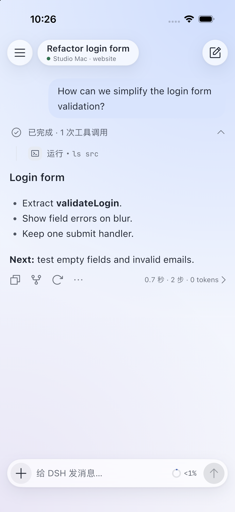
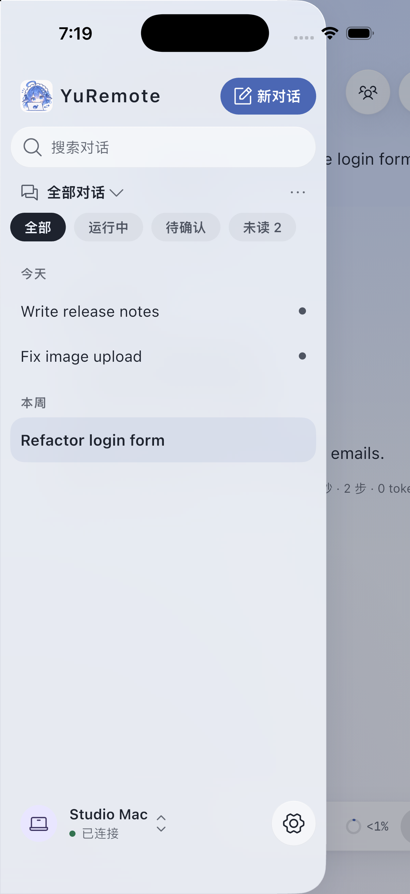
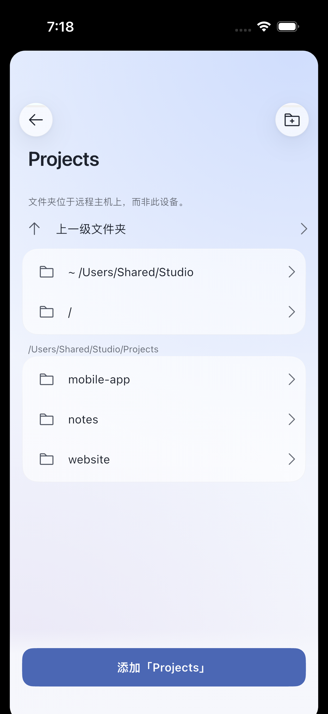
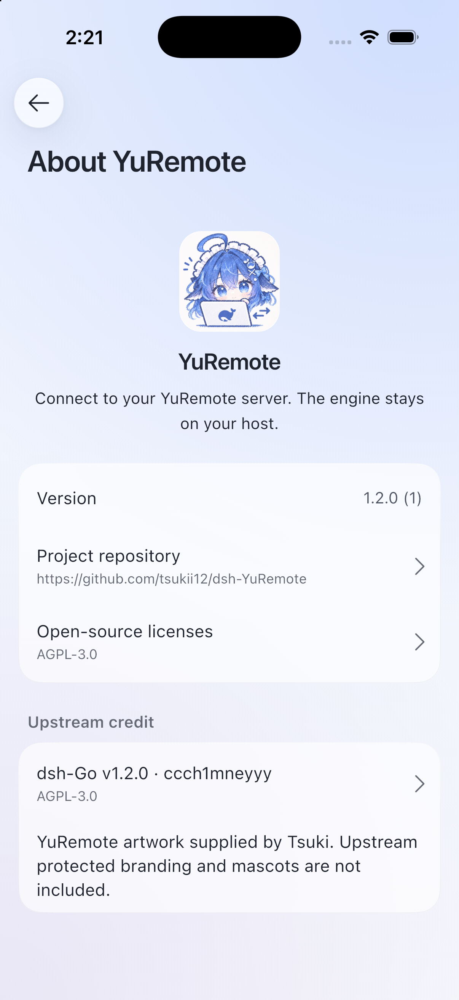

# iOS and Android app

[简体中文](APP.zh-CN.md) · [Documentation](README.md#english)

YuRemote is a remote-only Flutter port of dsh-Go v1.2.0. The app works with the YuRemote gateway, not with SSH or a plain DeepSeek Harness (DSH) Web URL. It does not run DSH locally or embed its website. Open and continue chats, stream responses, handle approvals and questions, and browse workspaces or attach files when the host supports those operations.

<div align="center">
  <table>
    <tbody>
      <tr>
        <td align="center"></td>
        <td align="center"></td>
        <td align="center"></td>
      </tr>
    </tbody>
  </table>
</div>

## Install

From the [latest release](https://github.com/tsukii12/dsh-YuRemote/releases/latest), choose the Android APK or unsigned iOS IPA.

- **Android:** open the arm64 APK on a 64-bit ARM device. Allow installation from the trusted download source if prompted. An APK signed with a different key cannot replace an existing installation; uninstalling clears the app's local settings and sign-in state.
- **iPhone/iPad:** sign the IPA yourself using a trusted tool or your Apple developer certificate and provisioning profile. The unsigned file cannot be installed directly. Follow your signing tool's instructions and enable Developer Mode if required. Alternatively, build and run from Xcode with your own signing team.

## Connect or pair

1. [Set up the host first](GETTING-STARTED.md). Use an address from **Local network** on the same Wi-Fi, or the HTTPS visitor address over the internet.
2. On the app's **Remote host** screen, enter the full portal URL, including the `/__t/<id>/` prefix for a relay, and the portal password. A server name is optional. Tap **Sign in**.
3. To pair without entering a password, use **Scan server or pairing link** on the same screen and scan the QR from **Local network**. Confirm the connection in the app. If the code was used or expired, generate a new one. On iOS, grant local network access if prompted for LAN use.

Denying camera permission does not prevent password login. If the app connects but an action is unavailable, check the host version and whether that host provides the RPC or file capability in question.

When agent-team mode is enabled for the conversation on the host, open **Agent team** to see members, tasks and messages. Tap an available member to open its conversation. On DSH 0.2.2, the app can show the team lead’s available subagents even when the host does not send a separate member list.

## Build from source

From an [installed checkout](GETTING-STARTED.md#install-on-the-host), use Flutter 3.47.7 (the CI version) and the Android SDK or Xcode. The package requires Dart ^3.13.4. On macOS, install the iOS toolchain for iOS builds.

```sh
cd app
flutter pub get
flutter build apk --release
# On macOS, build without signing for later signing:
flutter build ipa --release --no-codesign
```

For a development install on a connected device, use `flutter run` after selecting the target and configuring any required signing. See [development and testing](TESTING.md) for the active app checks.

## License and credits

The server, plugin, relay, installers and web remote remain [MIT](../LICENSE). The app and its accompanying Dart packages are [AGPL-3.0](../app/LICENSE), except where the notices indicate separate terms. The app is based on [ccch1mneyyy/dsh-Go v1.2.0, commit `c1a84e3f`](https://github.com/ccch1mneyyy/dsh-Go/commit/c1a84e3f833ad59ff07a5027994dae3935907a2d). The app and package source stays public. Keep the [app notice](../app/NOTICE), [package notices](../packages/NOTICE) and [third-party notices](../app/THIRD_PARTY_NOTICES.md) when redistributing.

The app uses YuRemote branding and Tsuki’s illustration, not dsh-Go’s excluded name, logo or mascots. See [branding and artwork](../app/ASSETS.md).

<p align="center">
  
</p>
