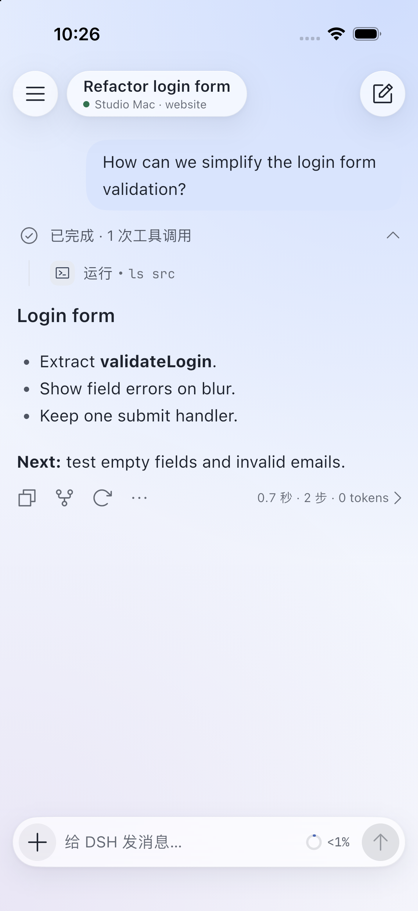
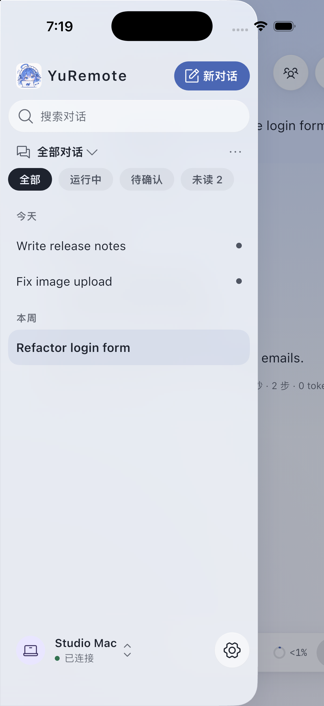
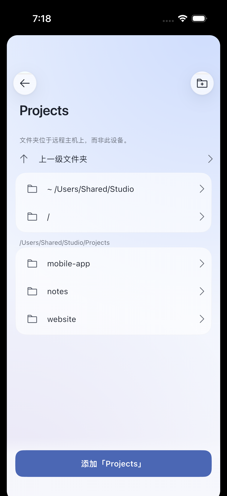
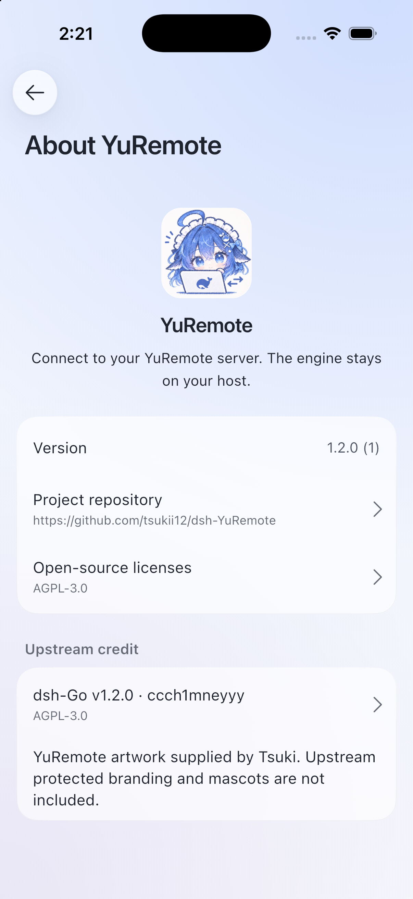

# iOS 和 Android 应用

[English](APP.md) · [文档目录](README.md#简体中文)

鱼鱼远程基于 dsh-Go v1.2.0 的 Flutter 界面移植，仅用于远程连接。应用需要鱼鱼远程网关，不支持通过 SSH 或普通 DeepSeek Harness（DSH）Web 地址连接；手机上不运行 DSH，也不嵌入网页。可打开并继续会话、接收流式回复、处理授权和提问；主机支持时，也能浏览工作区和添加附件。

  



## 安装

打开 [v0.7.0 发布页](https://github.com/tsukii12/dsh-YuRemote/releases/tag/v0.7.0)，选择 Android APK 或未签名的 iOS IPA。发布页当前的安装包文件名中标有 `0.7.1`。

- **Android：** 在 64 位 ARM 设备上打开 arm64 APK。若系统询问，请允许从受信任的下载来源安装。签名不同的 APK 无法覆盖已有安装；卸载会清除应用本地设置和登录状态。
- **iPhone/iPad：** 用可信的签名工具，或用自己的 Apple 开发者证书和描述文件为 IPA 签名。未签名的文件不能直接安装。按签名工具的提示操作，必要时打开开发者模式。也可以在 Xcode 中选择自己的签名团队后构建并运行。

## 连接或配对

1. [先配置主机](GETTING-STARTED.zh-CN.md)。在同一 Wi-Fi 下使用 **局域网访问** 中的地址；跨公网则使用 HTTPS 访客地址。
2. 在应用的 **远程主机** 页面，输入完整门户地址（中转地址保留 `/__t/<id>/` 前缀）和门户密码。服务器名称可选。点击 **登录**。
3. 若想免输密码，在同一页面使用 **扫描服务器或配对链接**，扫描 **局域网访问** 中的二维码，然后在应用内确认连接。二维码已使用或过期时请重新生成。iOS 若提示是否允许访问本地网络，局域网连接需选择允许。

拒绝相机权限不影响密码登录。如果连接成功但某项操作不可用，请检查主机版本，以及主机是否提供对应 RPC 或文件功能。

当主机为当前对话启用团队模式时，打开 **智能体团队** 可查看成员、任务和消息。点击可用成员即可打开其对话。在 DSH 0.2.2 上，即使主机未单独提供成员列表，应用也能显示团队负责人的可用子智能体。

## 从源码构建

在[检出目录](GETTING-STARTED.zh-CN.md#在主机上安装)中操作。使用 Flutter 3.47.7（CI 版本）及 Android SDK 或 Xcode；软件包要求 Dart ^3.13.4。构建 iOS 需要 macOS 和 iOS 工具链。

```sh
cd app
flutter pub get
flutter build apk --release
# 在 macOS 上构建不签名的归档，供后续签名：
flutter build ipa --release --no-codesign
```

选择连接的设备并配置必要签名后，可用 `flutter run` 安装开发版本。应用当前启用的检查见[开发与测试](TESTING.zh-CN.md)。

## 许可与致谢

服务端、插件、中继、安装脚本和网页远程端继续采用 [MIT](../LICENSE) 许可。应用及随附的 Dart 软件包采用 [AGPL-3.0](../app/LICENSE) 许可，声明中另有条款的内容除外。应用基于 [ccch1mneyyy/dsh-Go v1.2.0（提交 `c1a84e3f`）](https://github.com/ccch1mneyyy/dsh-Go/commit/c1a84e3f833ad59ff07a5027994dae3935907a2d)。应用和软件包源码保持公开，再分发时请保留[应用声明](../app/NOTICE)、[软件包声明](../packages/NOTICE)及[第三方声明](../app/THIRD_PARTY_NOTICES.md)。

应用使用鱼鱼远程品牌和 Tsuki 的插画，不使用 dsh-Go 未授权的名称、标志或吉祥物。详见[品牌与素材](../app/ASSETS.md)。
